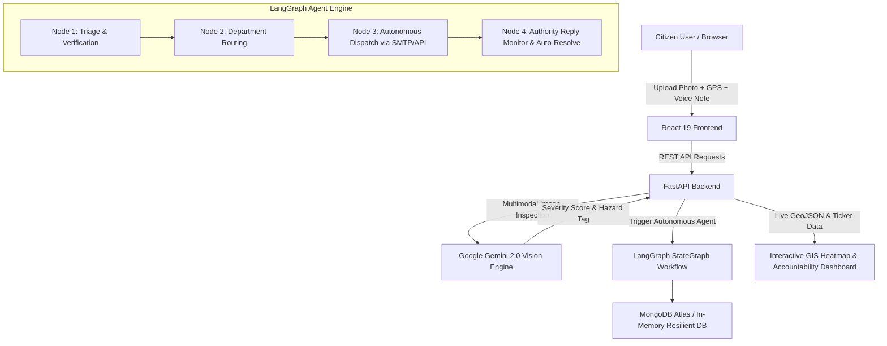

# 🏛️ CivicPulse: Autonomous Civic Infrastructure Triage & Accountability Platform

[](#)
[](#)
[](#)
[](#)
[](#)

---

## 🎯 Official Hackathon Problem Statement

### **Theme 1: Civic Pulse, Digital Governance & Public Information**
> **Selected Problem Track:**  
> **Transparent Civic Grievance & Infrastructure Triage System**  
> *"An open platform where citizens submit visual or audio reports of localized civic issues (e.g., road/bridge damage, pollution, water leaks, electrical hazards). The system automatically evaluates severity, routes issues to relevant authorities, and maintains public accountability dashboards."*

### ⚠️ The Real-World Dilemma
Modern civic grievance redressal fails because of a massive **bureaucratic disconnect**:
1. Citizens submit complaints into opaque portals that languish in unread municipal inboxes.
2. Inability to automatically discern **critical life-safety hazards** (e.g. exposed live cables or water main collapses) from routine wear.
3. Lack of dynamic community prioritization leaves repair resource allocation vulnerable to subjective bias.
4. Non-transparent closed systems lack public accountability dashboards and SLA tracking.

---

## 💡 The CivicPulse Solution

**CivicPulse** is an end-to-end decentralized civic infrastructure triage engine that bridges citizens and municipal departments using **Agentic AI**:

1. **Multimodal Citizen Reporting:** Visual evidence upload + GPS auto-pinning + Speech-to-Text accessibility across 6 major civic problem verticals:
   - 🛣️ **Roads & Pavement Infrastructure:** Potholes, asphalt crumbling, cave-ins, missing storm grates.
   - 🗑️ **Sanitation & Waste Management:** Illegal open dumping, overflowing bins, hazardous bio-waste.
   - 💧 **Water Supply & Drainage:** High-pressure pipe ruptures, sewage overflow, severe waterlogging.
   - ⚡ **Electrical & Power Hazards:** Fallen transmission cables, open junction boxes, street lighting outages.
   - 🛡️ **Public Infrastructure & Safety:** Damaged guardrails, collapsed signboards, broken walkways.
   - 🌿 **Environmental Cell:** Industrial runoff, toxic stagnant pools, environmental violations.
2. **Multimodal Vision & Severity AI (Google Gemini):** Inspects visual damage, scores severity (1–100), tags danger levels (`CRITICAL`, `HIGH`, `MEDIUM`, `LOW`), and formulates technical triage briefs.
3. **Autonomous Bureaucracy Execution Agent (LangGraph):** A multi-node StateGraph agent that validates complaints, matches jurisdictional municipal agencies, creates official dispatch briefs with SLA timers, dispatches email/API notices, and monitors response feedback to automatically close tickets.
4. **Democratic Community Prioritization:** Community upvoting dynamically recalculates civic priority:
   $$\text{Priority} = (\text{SeverityScore} \times 1.2) + (\text{Upvotes} \times 4) - (\text{Downvotes} \times 2)$$
5. **Open Accountability Ledger & Interactive GIS Heatmap:** Public interactive map, resolution statistics, category distribution, and SLA escalation alerts.

---

## 🏗️ System Architecture



---

## 📁 Project Structure

```
CivicPulse/
│
├── .env.example                     # Unified environment template
├── .gitignore                       # Global Git ignore rules (secrets, caches, build files)
├── .dockerignore                    # Docker build exclusion rules
├── docker-compose.yml               # Multi-container orchestration (FastAPI + React + MongoDB)
├── start-dev.bat                    # Windows 1-click full-stack dev launcher
├── start-dev.sh                     # Linux/macOS dev launcher
├── README.md                        # Master project documentation & architecture guide
│
├── backend/                         # FastAPI Backend
│   ├── .env.example                 # Backend environment example
│   ├── Dockerfile                   # Backend container definition
│   ├── requirements.txt             # Python dependencies
│   ├── main.py                      # FastAPI app entrypoint & CORS middleware
│   ├── database.py                  # PyMongo client + in-memory resilient fallback
│   ├── models.py                    # Pydantic data models & Civic categories
│   ├── routers/
│   │   ├── __init__.py              # Routers package marker
│   │   ├── auth.py                  # JWT authentication & Citizen/Admin login
│   │   ├── complaints.py            # Multimodal grievance filing, voting, lifecycle
│   │   ├── analytics.py             # Public accountability ledger metrics
│   │   └── agent.py                 # LangGraph agent triggers & audit log API
│   └── services/
│       ├── __init__.py              # Services package marker
│       ├── vision_service.py        # Gemini 2.0 Flash + Roboflow computer vision triage
│       ├── agent_service.py         # LangGraph StateGraph autonomous agent workflow
│       └── storage_service.py       # Cloudinary / Base64 image storage service
│
└── frontend/                        # React Single Page App (Vite)
    ├── .env.example                 # Frontend environment example
    ├── Dockerfile                   # Frontend production Nginx multi-stage build
    ├── package.json                 # React 19, Lucide, Leaflet dependencies
    ├── vite.config.js               # Vite bundler config
    ├── README.md                    # Frontend client documentation
    ├── public/                      # Static assets & SVG icons
    └── src/
        ├── App.jsx                  # Main application state & tab coordinator
        ├── api.js                   # Unified API client & Auth handlers
        ├── index.css                # Modern design system & glassmorphism tokens
        └── components/
            ├── Navbar.jsx           # Header & tab switcher
            ├── HeroSection.jsx      # Track Concept banner & category shortcuts
            ├── GrievanceFeed.jsx    # Complaint cards, community voting & triage details
            ├── CivicMap.jsx         # Interactive Leaflet GIS map with glowing category pins
            ├── TransparencyDashboard.jsx # Public SLA accountability charts
            ├── AgentCommandCenter.jsx    # LangGraph topology & live terminal audit logs
            ├── ReportModal.jsx      # Multimodal grievance submission & AI preview
            └── AuthModal.jsx        # Citizen & Evaluator 1-click Demo login
```

---

## ⚡ Quickstart Guide

### 1. Backend Setup (FastAPI)

1. Open a terminal in the root directory and navigate to `backend/`:
   ```bash
   cd backend
   ```
2. Install Python dependencies:
   ```bash
   pip install -r requirements.txt
   ```
3. Configure your `.env` (optional - pre-configured with fallback defaults):
   ```ini
   PORT=8000
   MONGODB_URI=mongodb://localhost:27017/civic_pulse_db
   GEMINI_API_KEY=your_gemini_api_key_here
   ```
4. Start the FastAPI development server:
   ```bash
   uvicorn backend.main:app --reload --port 8000
   ```
   *FastAPI documentation will be live at `http://localhost:8000/docs`.*

---

### 2. Frontend Setup (React + Vite)

1. Open a second terminal and navigate to `frontend/`:
   ```bash
   cd frontend
   ```
2. Install NPM dependencies (if not already installed):
   ```bash
   npm install
   ```
3. Start the Vite React development server:
   ```bash
   npm run dev
   ```
4. Open your browser and navigate to:
   ```
   http://localhost:5173
   ```

---

## 🧪 Testing & Demo Credentials

To make evaluation seamless for judges:
- **1-Click Demo Buttons** are provided in the Sign In modal:
  - **Municipal Admin / Nodal Officer:** `admin@civicpulse.org` / `admin123` (unlocks administrative review actions & in-progress overrides).
  - **Citizen User:** `citizen.demo@civicpulse.org` / `citizen123`.
- **Zero-Setup Resilience:** If MongoDB Atlas or Gemini API keys are omitted, the platform uses an intelligent deterministic vision fallback and memory persistence so the full UI and LangGraph agent workflow can be demonstrated immediately without network stalls.
